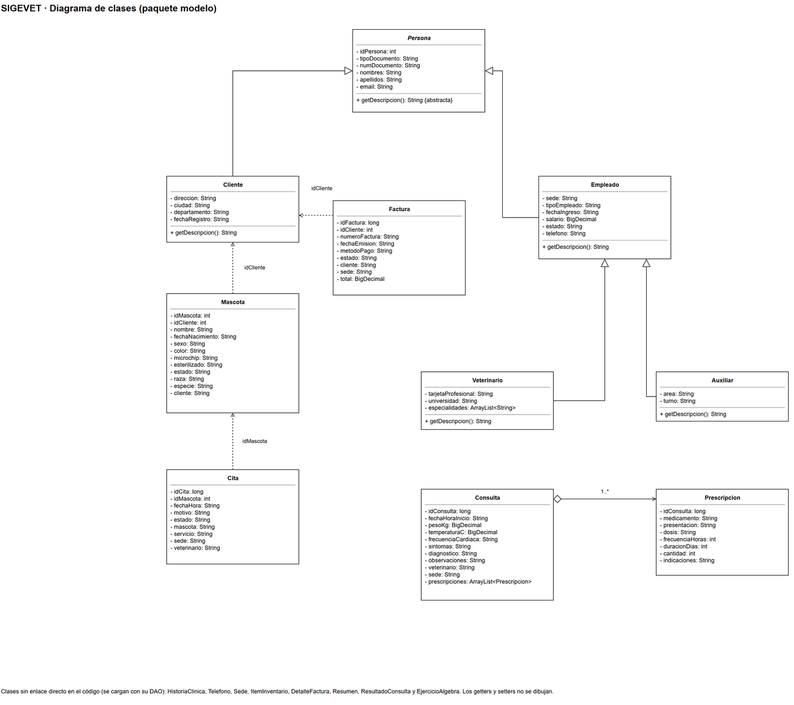

## Un trabajo de equipo

La aplicación es del equipo de SIGEVET. Según la propuesta del proyecto, la web estaba a cargo de Juan Miguel Ramos Sevilla, desarrollador web e infraestructura, y el repositorio y el cierre, de Sergio Alejandro Parra Rivera, verificador e integrador. La [ficha general](/projects/sigevet-proyecto-final/) tiene al equipo completo.

## Arquitectura

Todo se entrega en un solo `sigevet.jar`. El backend es una API REST en Java 21 con Spring Boot 3.5 que responde JSON y accede a la base con JDBC, sin ORM. El frontend es una aplicación Angular 21 con Bootstrap 5 que pide los datos a la API con `HttpClient` y nunca se conecta a MySQL. `ng build` genera el frontend y Maven lo copia a `static/` dentro del jar, de modo que Spring Boot sirve las páginas y la API por el puerto 5000.

```text
Navegador (Angular) --HTTP 5000 /api--> Controller --> Service --> DAO (JDBC) --> MySQL 8.4 (vet_app)
        ^                                  |
        +------------- JSON ---------------+
```

El controlador recibe la petición, el servicio valida y aplica las reglas, y el DAO ejecuta el SQL.

## Capas del backend

| Paquete | Qué tiene |
| :-- | :-- |
| `connection/` | `ConexionBD` abre la conexión con `DriverManager`; `Transaccion` hace el rollback y cierra |
| `model/` | Clases con atributos privados, getters y setters: `Persona`, `Cliente`, `Empleado`, `Veterinario`, `Auxiliar`, `Mascota`, `Cita`, `Factura` y los enums de estados |
| `dto/` | Las respuestas y los formularios de POST y PUT |
| `dao/` | Una clase por tema con su SQL: clientes, mascotas, citas, facturas, inventario y personal |
| `service/` | Un servicio por tema: valida, aplica las reglas y coordina los DAO |
| `controller/api/` | Un controlador REST por recurso |
| `exception/` | Las excepciones de 404, 400 y 409, y el manejador que las convierte en JSON |
| `util/` | El validador de formularios y el traductor de los errores de MySQL |
| `config/` | Sirve el frontend y devuelve `index.html` en las rutas de Angular |
| `algebra/` | Lee los 55 ejercicios de álgebra relacional desde su archivo SQL |

## Herencia y polimorfismo

La jerarquía de clases reproduce la especialización EMPLEADO, VETERINARIO y AUXILIAR del modelo extendido. `Persona` es abstracta, con un método `getDescripcion()` que cada subclase implementa a su manera, y el DAO de personal crea un `Veterinario`, un `Auxiliar` o un `Empleado` según el tipo de cada fila, todos dentro de una misma lista.



[Ver el diagrama de clases a tamaño completo (PNG)](/evidencias/proyecto-final-sigevet/diagramas/clases.png)

```java
Empleado empleado;
String tipoEmpleado = rs.getString("tipo_empleado");
if ("VET".equals(tipoEmpleado)) {
    empleado = new Veterinario();
} else if ("AUX".equals(tipoEmpleado)) {
    empleado = new Auxiliar();
} else {
    empleado = new Empleado();
}
```

## Conexión a MySQL

MySQL Connector/J conecta por JDBC. `ConexionBD` abre una conexión por operación y el DAO la cierra con `try-with-resources`; los parámetros se asignan con `PreparedStatement`. La conexión se configura con variables de entorno y la clave no se escribe en el código ni en GitHub.

| Dato | Variable de entorno |
| :-- | :-- |
| URL JDBC de la base `sigevet` | `SIGEVET_DB_URL` |
| Usuario de la aplicación, `vet_app` | `SIGEVET_DB_USER` |
| Clave del usuario | `SIGEVET_DB_PASSWORD` |

## API REST

Cada controlador llama a su servicio y devuelve un objeto que Spring convierte en JSON:

```java
@GetMapping("/{id}")
public ClienteDetalleDTO detalle(@PathVariable int id) {
    return clienteService.detalle(id);
}
```

| Recurso | Lectura | Escritura |
| :-- | :-- | :-- |
| Sesión | `GET /api/sesion` | `POST` para entrar y `DELETE` para salir |
| Clientes | `GET /api/clientes` y `GET /api/clientes/{id}` | `POST`, `PUT /{id}` y `DELETE /{id}` solo sin historial |
| Mascotas | `GET /api/mascotas` y `GET /api/mascotas/{id}` | `POST`, `PUT /{id}` y `PATCH /{id}/estado` |
| Citas | `GET /api/citas` con filtros de sede y estado | `POST` y `PATCH /{id}/estado` |
| Facturas | `GET /api/facturas` y `GET /api/facturas/{id}` | `POST` con sus líneas y `PATCH /{id}/estado` |
| Inventario | `GET /api/inventario` por sede | `POST`, `PUT` y `DELETE` |
| Personal | `GET /api/personal` por sede | `POST`, `PUT /{id}` y `PATCH /{id}/estado` |
| Álgebra | `GET /api/algebra` y `GET /api/algebra/{numero}` | No tiene |

Las mascotas, los empleados, las citas y las facturas cambian de estado en vez de borrarse, porque deben conservarse.

## Transacciones con JDBC

Cuando una operación escribe en varias tablas, el DAO abre la transacción a mano. Al crear una factura se inserta el encabezado y las líneas y, si se vende un medicamento, se descuenta el inventario de la sede, solo si alcanza el stock. Si algo falla, se deshace todo.

```java
conexion = conexionBD.conectar();
conexion.setAutoCommit(false);
// 1. consecutivo FV-... (SELECT ... FOR UPDATE)
// 2. INSERT INTO FACTURA ...
// 3. por línea: INSERT INTO DETALLE_FACTURA ... y, si es medicamento,
//    UPDATE INVENTARIO SET stock_actual = stock_actual - ?
//    WHERE ... AND stock_actual >= ?
conexion.commit();
} catch (SQLException e) {
    Transaccion.deshacer(conexion);
    throw ErroresSQL.traducir(e);
} finally {
    Transaccion.cerrar(conexion);
}
```

El mismo patrón se usa al crear un empleado con su subtipo y al anular una factura, que devuelve los medicamentos al inventario.

## Validación en tres niveles y errores de la base

1. **Formulario en Angular:** campos obligatorios, longitudes y formatos.
2. **Servicio en Java:** documentos de 6 a 10 dígitos, nombres solo con letras, teléfonos de 7 a 10 dígitos, microchip de 15 dígitos, fechas y rangos. Si falla, la API responde 400.
3. **Base de datos:** CHECK, UNIQUE, llaves foráneas y disparadores. La aplicación no los repite en Java: si MySQL rechaza un dato, se traduce el error y la página lo muestra.

| Error de MySQL | Respuesta de la API |
| :-- | :-- |
| SQLSTATE 45000 (`SIGNAL` de un disparador) | 409 con el mensaje de la regla de negocio que dio la base |
| 1062 (valor repetido en PK o UNIQUE) | 409: ya existe un cliente con ese tipo y número de documento |
| 3819 (CHECK) | 409 con el nombre de la restricción que se incumplió |
| 1451 y 1452 (llave foránea) | 409: tiene registros relacionados, o el dato seleccionado no existe |

## Seguridad y sesión

- **Mínimo privilegio:** `vet_app` lee toda la base y escribe solo en las tablas que modifica la aplicación, sin `DROP`, `ALTER` ni `CREATE`.
- **Sin inyección de SQL:** todo el SQL usa `PreparedStatement` con parámetros, y Angular muestra los datos como texto, que escapa el HTML. La ruta de álgebra elige un ejercicio por su número y no recibe SQL.
- **Sesión de demostración:** solo el personal entra, con su correo corporativo y su número de documento, que hace de contraseña; no hay una tabla de usuarios aparte porque esos datos ya están en `EMPLEADO`. El proyecto declara fuera de su alcance las contraseñas cifradas. Un empleado inactivo no entra, y un filtro de sesión revisa cada petición y responde 401 si no hay sesión.

## Pruebas de la API contra MySQL

| Prueba | Respuesta | Resultado |
| :-- | :-- | :-- |
| `GET /api/clientes` sin iniciar sesión | 401 | La API no ejecuta la consulta |
| `POST /api/sesion` con un documento que no corresponde | 401 | Correo o documento incorrectos |
| `POST /api/sesion` con `x' OR '1'='1` en los dos campos | 401 | La inyección no funciona: los valores van como parámetros |
| `POST /api/sesion` con un veterinario activo | 200 | Sesión iniciada |
| `DELETE /api/sesion` y luego `GET /api/clientes` | 204 y 401 | Al salir, la API vuelve a pedir inicio de sesión |
| `GET /api/algebra/1` a `/api/algebra/55` | 200 | Los 55 ejercicios de álgebra se ejecutan en MySQL |
| `POST /api/clientes` con un cliente nuevo y un teléfono | 201 | Se creó el cliente 46 con su teléfono |
| `POST /api/clientes` con el mismo documento | 409 | La base lo rechazó por UNIQUE |
| `POST /api/clientes` con letras en el documento | 400 | Lo rechazó la validación de Java |

## El frontend

El frontend de Angular usa módulos (`NgModule`) y una carpeta por página con el sufijo `component`: inicio, inicio de sesión, clientes, mascotas, agenda, inventario, facturas, personal y álgebra, con sus detalles y formularios, más la barra de navegación y el pie de página. Un servicio por recurso llama a la API, las rutas pasan por un guard de sesión, y un interceptor lleva a la pantalla de inicio de sesión cuando la API responde 401.

## Documento del trabajo

- [Conexión de la aplicación web a la base de datos (PDF)](/evidencias/proyecto-final-sigevet/fase2-06-conexion-aplicacion-web.pdf)
- [Diagrama de clases del paquete modelo (PNG)](/evidencias/proyecto-final-sigevet/diagramas/clases.png)
- [Repositorio del equipo en GitHub](https://github.com/Estarlan/proyecto-bd1-sigevet), carpetas `app` y `frontend`

---

### Contexto

Entrega del proyecto final de **Bases de Datos 1** (Universidad El Bosque, Ingeniería de Sistemas, periodo 2026-2), hecha por un equipo de cuatro integrantes: Juan David Polo Herrera, Sebastián Castellanos Parra, Juan Miguel Ramos Sevilla y Sergio Alejandro Parra Rivera. En el PDF se omitieron los números de documento de los integrantes que aparecían en la portada.
