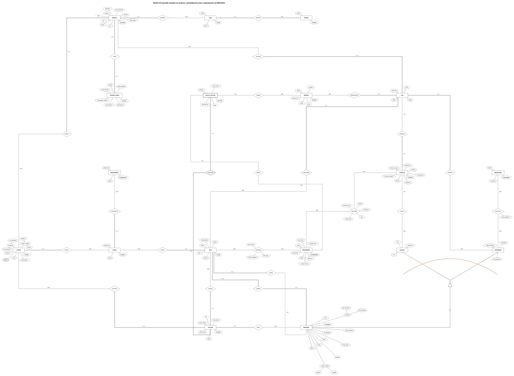
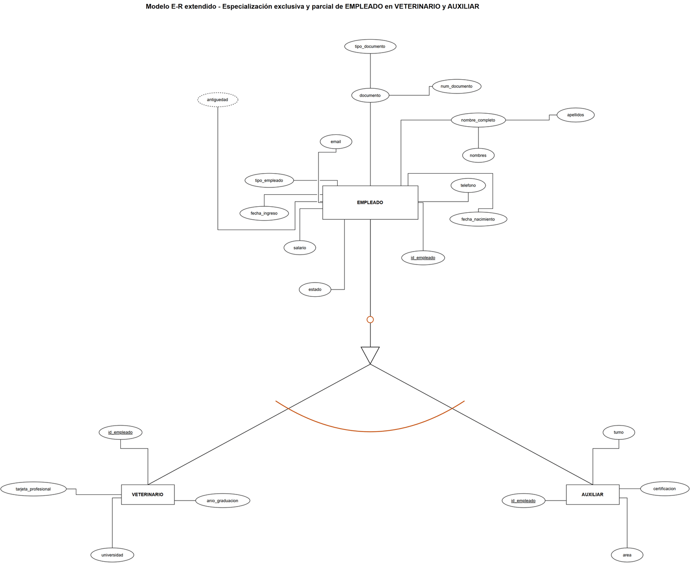
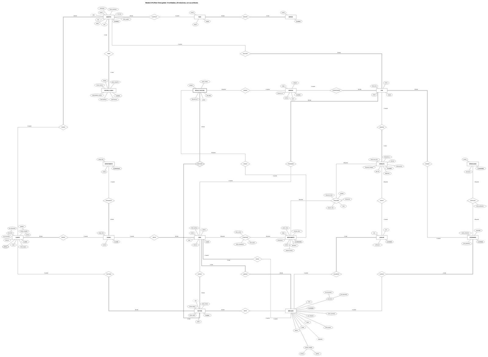
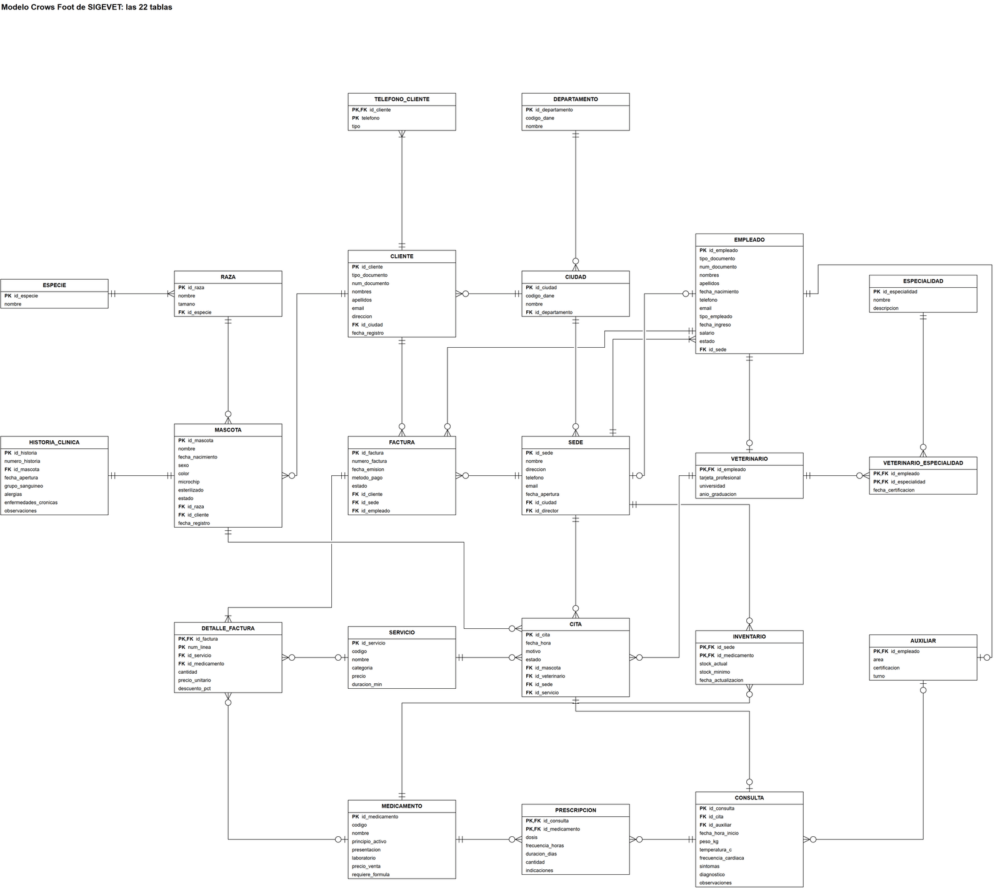
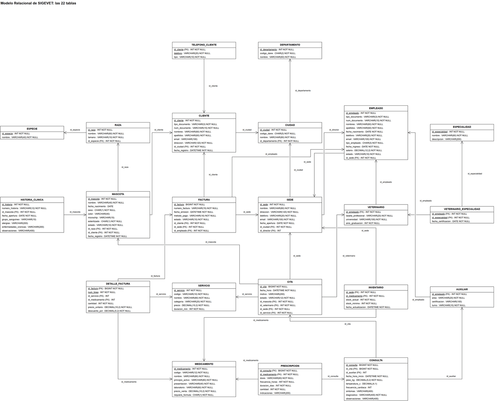
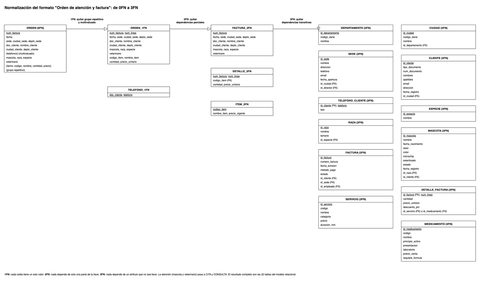

## Un trabajo de equipo

SIGEVET es el proyecto final de Bases de Datos 1 de un equipo de cuatro integrantes, y esta ficha documenta su Fase 1: el diseño de los datos. La propuesta del proyecto reparte los roles así: Sebastián Castellanos Parra, analista y modelador de datos, a cargo de los requerimientos, los supuestos, los modelos Chen y EER y el diccionario; Juan David Polo Herrera, gerente del proyecto y DBA, del modelo relacional, la normalización y los scripts; Juan Miguel Ramos Sevilla, de desarrollo web e infraestructura, del álgebra, el SQL, la máquina virtual y la web; y Sergio Alejandro Parra Rivera, verificador e integrador, del RDBMS, la verificación, el repositorio y el cierre. La [ficha general del proyecto](/projects/sigevet-proyecto-final/) reúne al equipo y el resto de entregables.

## El caso

Huella Sana S.A.S. es una red de clínicas veterinarias inventada para el curso: fundada en Bogotá en 2018, con cinco sedes (Usaquén y Chapinero en Bogotá, Chía en Cundinamarca, Laureles en Medellín y San Fernando en Cali) y 27 empleados. Atiende perros, gatos, aves, conejos y hámsteres. Los problemas de partida eran estos:

| Síntoma | Causa | Consecuencia |
| :-- | :-- | :-- |
| Citas cruzadas | Agendas separadas | Tiempos muertos |
| Historia incompleta entre sedes | Carpetas separadas | Alergias y tratamientos desconocidos |
| Agotados y sobrestock | Sin stock mínimo | Ventas perdidas y capital inmovilizado |
| Clientes duplicados | Registro por sede | Anomalías de actualización |
| Ingresos desconocidos | Facturación separada | Decisiones sin datos |

La pregunta que guía el diseño es cómo centralizar cinco sedes en una base clínica, operativa y comercial en tercera forma normal, consultable desde la web.

## El modelo conceptual

El modelo tiene 18 entidades (17 fuertes y una débil, `DETALLE_FACTURA`) y 26 relaciones: 5 de uno a uno (DIRIGIR, TENER, GENERAR y las dos de la especialización), 18 de uno a muchos y 3 de muchos a muchos (CERTIFICAR, PRESCRIBIR y ALMACENAR). La versión de Draw.io tiene 26 hojas: el modelo completo, una vista por área y una hoja por cada transformación.

[Ver el modelo extendido a tamaño completo (PNG)](/evidencias/proyecto-final-sigevet/diagramas/eer-completo.png)

EMPLEADO es la única entidad que se especializa. VETERINARIO guarda los datos profesionales y AUXILIAR el área, la certificación y el turno; la especialización es disyunta (nadie es las dos cosas) y parcial (también hay personal administrativo).

## Del modelo conceptual a las tablas

Cada caso que no se traduce directo a una tabla tiene su propio diagrama de transformación:

| Caso | Cómo se resolvió |
| :-- | :-- |
| Atributo multivaluado (teléfonos del cliente) | Una tabla aparte con el cliente y cada teléfono, que además cumple la primera forma normal |
| N:M PRESCRIBIR | Una tabla de prescripción con medicamento, dosis, frecuencia, duración y cantidad |
| N:M ALMACENAR | Un inventario por sede y medicamento, con stock actual y stock mínimo |
| N:M CERTIFICAR | Las especialidades certificadas de cada veterinario, con su fecha |
| Entidad débil `DETALLE_FACTURA` | Cada línea depende de su factura y es un servicio o un medicamento, nunca los dos |

## Cuatro notaciones

El mismo diseño se dibujó en las notaciones que pide el curso: Chen con los catálogos de atributos, Barker y Crow's Foot, además del EER. Cada una tiene una vista global y ampliaciones por área para que se pueda leer.

## Modelo relacional y normalización

El modelo relacional resultante tiene 22 tablas. La propuesta resume así el camino a la tercera forma normal: los teléfonos se llevan a su propia tabla (1FN), el detalle de factura se separa de la factura (2FN), y la raza depende de la especie y la ciudad del departamento, de modo que ninguno de esos datos se repite (3FN).

## Supuestos y reglas de negocio

El documento de supuestos fija las reglas que el modelo debe respetar y la forma de implementarlas. Las dos últimas no se pueden declarar en una tabla y se resolvieron con disparadores en la Fase 2.

| Regla | Qué dice | Implementación |
| :-- | :-- | :-- |
| RN-01 | Código DANE de 2 dígitos para el departamento y de 5 para el municipio | `CHECK` con expresión regular |
| RN-02 | Salario, precios de catálogo y cantidades positivos; precio unitario histórico no negativo | `CHECK` mayor que 0 |
| RN-03 | Stock actual y mínimo no negativos | `CHECK` mayor o igual a 0 |
| RN-04 | Temperatura entre 30 °C y 45 °C | `CK_CONSULTA_TEMPERATURA_C` |
| RN-05 | Descuento entre 0 % y 100 % | `CK_DETALLE_FACTURA_DESCUENTO_PCT` |
| RN-06 | Estado de la cita: programada, atendida, cancelada o no asistió | `CK_CITA_ESTADO` |
| RN-07 | Borrar una factura o una consulta borra sus líneas o su fórmula | `ON DELETE CASCADE` |
| RN-08 | El veterinario de una cita labora en la sede de la cita | Disparador (Fase 2) |
| RN-09 | VETERINARIO y AUXILIAR corresponden al tipo de empleado | Disparador (Fase 2) |

Los datos de prueba son ficticios y se generan con una semilla fija, y los nombres de las restricciones siguen un prefijo por tipo: `PK_`, `FK_`, `UQ_` y `CK_`.

## Documento del trabajo

- [Propuesta del proyecto (PDF)](/evidencias/proyecto-final-sigevet/fase1-01-propuesta-del-proyecto.pdf)
- [Documento de supuestos (PDF)](/evidencias/proyecto-final-sigevet/fase1-02-documento-de-supuestos.pdf)
- [Diccionario de datos (PDF)](/evidencias/proyecto-final-sigevet/fase1-07-diccionario-de-datos.pdf)
- Modelos de MySQL Workbench: [Barker](/evidencias/proyecto-final-sigevet/workbench/mer-barker-workbench.pdf), [Crow's Foot](/evidencias/proyecto-final-sigevet/workbench/mer-crowsfoot-workbench.pdf) y [relacional](/evidencias/proyecto-final-sigevet/workbench/modelo-relacional-workbench.pdf) (PDF)
- Diagramas de Draw.io a tamaño completo (PNG): [EER](/evidencias/proyecto-final-sigevet/diagramas/eer-completo.png), [Chen](/evidencias/proyecto-final-sigevet/diagramas/chen-global.png), [Crow's Foot](/evidencias/proyecto-final-sigevet/diagramas/crowsfoot-global.png), [relacional](/evidencias/proyecto-final-sigevet/diagramas/relacional-global.png), [normalización](/evidencias/proyecto-final-sigevet/diagramas/normalizacion.png) y [especialización de EMPLEADO](/evidencias/proyecto-final-sigevet/diagramas/especializacion-empleado.png)
- [Repositorio del equipo en GitHub](https://github.com/Estarlan/proyecto-bd1-sigevet), carpeta `documentos/fase1`

---

### Contexto

Entrega de la Fase 1 del proyecto final de **Bases de Datos 1** (Universidad El Bosque, Ingeniería de Sistemas, periodo 2026-2), hecha por un equipo de cuatro integrantes: Juan David Polo Herrera, Sebastián Castellanos Parra, Juan Miguel Ramos Sevilla y Sergio Alejandro Parra Rivera. Docente: Ing., Esp., M.Ed. Christian Felipe Duarte Arévalo. En los PDF se omitieron los números de documento de los integrantes que aparecían en las portadas.
